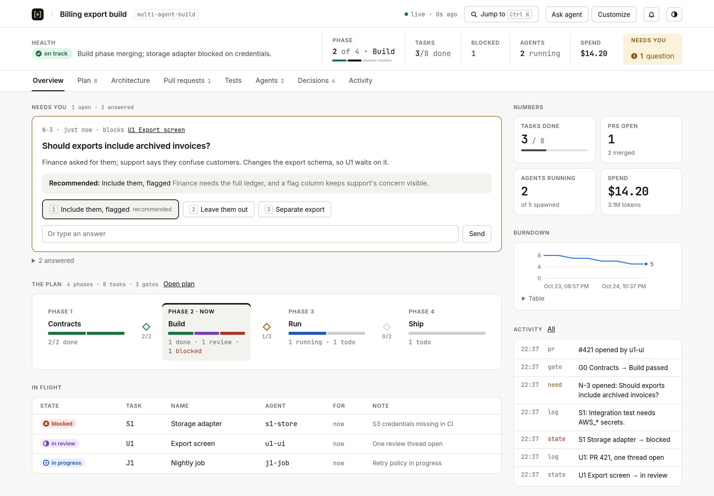
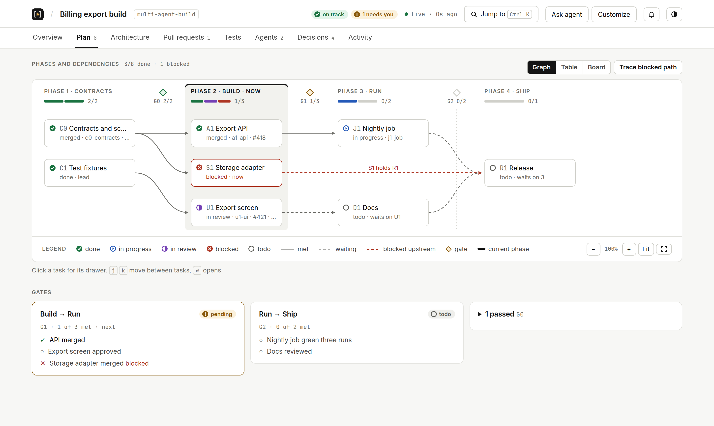
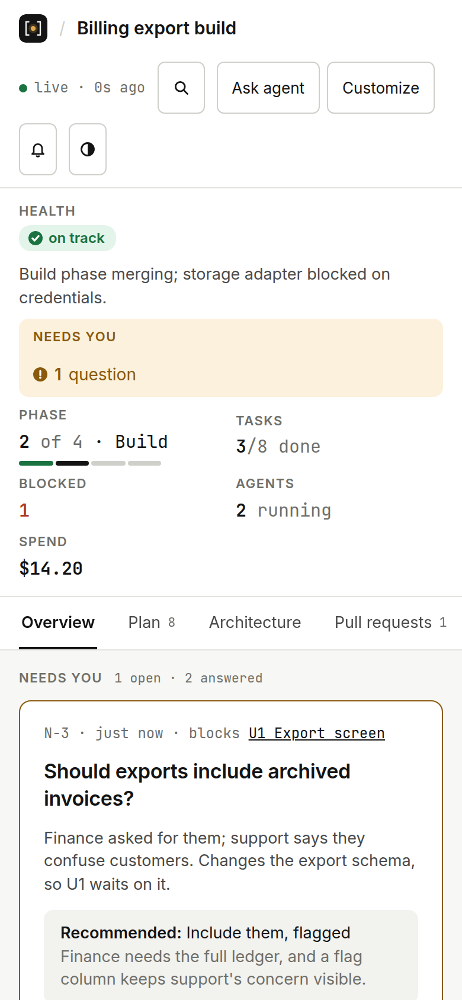

<div align="center">

<picture>
  <source media="(prefers-color-scheme: dark)" srcset=".design/logo/wordmark-dark.svg">
  
</picture>

**A live mission control for every coding-agent run, shaped the way you want it.**

Your agent works through a long task: packages, pull requests, tests, subagents, decisions.<br>
mission-control gives that run one page that shows where it stands, what's waiting on you, and buttons to act on it.

[Install](#install) · [Use it](#use-it) · [Make it yours](#make-it-yours) · [Troubleshooting](#troubleshooting)

Built for **Claude Code** first; works from any agent that can run a command.

<br>

<picture>
  <source media="(prefers-color-scheme: dark)" srcset="docs/screenshots/overview-dark.png">
  
</picture>

<sub><i>The Overview of a multi-agent build: is it healthy, what needs you, where are we.</i></sub>

<picture>
  <source media="(prefers-color-scheme: dark)" srcset="docs/screenshots/plan-dark.png">
  
</picture>

<sub><i>The Plan: every dependency and blocked path, drawn. Click a task for its history; zoom, fit or go fullscreen.</i></sub>



<sub><i>On a phone. Screenshots are generated by <code>just screenshots</code>.</i></sub>

</div>

## Why

Long agent runs scatter their state across the chat: which PR is green, which subagent is stuck, which question you still owe an answer. mission-control collects it on **one page that stays current**, and keeps it out of the chat.

- **One glance.** A status strip answers *is it healthy, what needs me, where are we* on every page; the Overview adds what's in flight, the numbers and recent activity. Plans, PRs, tests, agents and decisions each get a tab.
- **What needs you, on top.** Questions come with options, a recommendation and why, and their count is always in view.
- **Yours to shape.** Every section, column, link, color and button is config. Set your defaults once; let the agent change one page when you ask.
- **Every run, one place.** One small local service serves every mission from every session, and keeps them after a restart.
- **Stays local.** Runs on `127.0.0.1`; nothing leaves your machine.

## Install

Paste this into your coding agent:

> Install mission-control from https://github.com/Rfluid/mission-control for all my coding agents. Follow its `INSTALL.md`.

The agent clones the latest release, builds it (or downloads a prebuilt binary), and sets mission-control up for your agents. Restart your agent sessions afterwards.

<details>
<summary>Install by hand</summary>

```sh
git clone https://github.com/Rfluid/mission-control ~/tools/mission-control   # keep it somewhere permanent
~/tools/mission-control/scripts/checkout-release.sh                   # switch to the latest release
~/tools/mission-control/bin/mission-control install --dry-run                 # builds it on first run (or downloads it without Rust); shows what install would change
~/tools/mission-control/bin/mission-control install                           # skill, CLI (also as `mctl`) and MCP server for every agent found
```

`mission-control doctor` checks the setup; `mission-control uninstall` undoes it.
</details>

## Use it

1. Ask your agent to track the run:
   > Start a mission control for this build and keep it current.
2. Open the page it gives you (`http://127.0.0.1:7466/m/…`). `http://127.0.0.1:7466/` lists every mission, with the questions waiting on you across all of them first.
3. Watch it update live as the agent works (the dot says *live*, or *reconnecting*). Anything waiting on you shows under **Needs you**, counted in the strip at the top of every page, with the agent's recommendation: click an option or type an answer, and the agent gets it. Buttons on rows (re-run CI, mark passed, …) and **Customize** ("hide spend", "add a column for owner") reach the agent the same way.

Away from the tab? The tab title counts open questions and the icon turns to the run's health. Click the bell once to get a browser notification for a new question or a newly blocked task (never for progress).

From the keyboard: **⌘K** (Ctrl+K) jumps to any page, task, question or button; **?** lists every shortcut; on a plan, **j** / **k** walk the tasks and **Enter** opens one.

Pick a starting layout by name, or let the agent choose:

| Template | For |
|---|---|
| `minimal` | Any run: questions for you, a status note, the activity log |
| `multi-agent-build` | A lead agent running tasks in phases through subagents. Tabs: Overview, Plan (tasks, gates), Architecture, Pull requests, Tests, Agents (and spend), Decisions (and risks), Activity |
| `pr-babysit` | Getting a set of pull requests through review and CI |
| `research` | Questions under investigation and findings with sources |

## Make it yours

Tell the agent what you want, and say how far it should go:

| You say | What changes |
|---|---|
| "Hide spend **on this page**." | This mission only |
| "**For this repo**, link PRs to our GitHub org." | Everyone working in this repo (`.mission-control/config.toml`, committed) |
| "**Always** add a Re-run CI button to PR tables." | Every mission you start (`~/.config/mission-control/config.toml`) |
| "Make this layout a template called `standup`." | A new template you can start from |

You can also edit the files yourself. A small example: add a button to every PR table, in every mission:

```toml
# ~/.config/mission-control/config.toml
[actions.rerun-ci]
label = "Re-run CI"
kind = "ask_agent"
message = "Re-run CI on PR {row.key}"

[[sections]]
id = "prs"
row_actions = ["rerun-ci"]
```

Changes stack: the built-in layout, then the template, then your defaults, then the repo's, then this mission's. You only write what differs. To see where any setting came from:

```sh
mission-control config explain -m <id> 'sections[prs]'   # <id> is the msn_… in the page's address
```

The full reference is [docs/CONFIG.md](docs/CONFIG.md); ready-to-copy examples are in [examples/](examples/README.md).

## Fills itself (Claude Code)

With mission-control's hooks, the page tracks subagents, the pull requests your agent opens and merges, and token spend (an estimate from list prices) on its own. Ask your agent to set them up, or see `INSTALL.md`.

## Comment on the page itself

With [redline](https://github.com/Rfluid/redline) installed, `mission-control review -m <id>` (or ask your agent) lets you select anything on the page and comment on it; the agent gets your comments through redline.

## Share a snapshot

`mission-control export -m <id> -o run.html` writes the page as one static file: no service needed to open it, no token in it, buttons switched off. Send it, attach it, or publish it.

## Coming from a hand-built mission control?

If your agent kept a `state.json` (packages, PRs, tests, needs, an activity log), bring it over:

```sh
mission-control import path/to/state.json --project path/to/repo
```

It becomes a mission with the same rows and history, on the `multi-agent-build` layout.

## Good to know

- **Everything stays on your machine.** mission-control runs a small local service on `127.0.0.1`. Nothing is sent anywhere else.
- **One service for all sessions.** It starts when first needed. Missions are kept in `~/.local/state/mission-control/` (Windows: `%LOCALAPPDATA%\mission-control\`).
- **Buttons that run commands** are off unless you turn them on, and only ever come from your own config files, never from the agent.

## Troubleshooting

| Problem | Try |
|---|---|
| Agent doesn't know about mission-control | Restart the session. Check `INSTALL.md` was followed |
| The page says *unreachable* | The local service isn't running. Run any `mission-control` command, e.g. `mission-control list`, then reload |
| A section looks wrong or is missing | `mission-control config explain -m <id>` shows which file or change set it, and any config problems |
| A yellow or red *Config* banner | It names the setting that's wrong; fix that file, or ask the agent to |
| Too many old missions on the index | `mission-control archive -m <id>` (nothing is deleted; `--restore` brings it back) |
| Is the local service running? | `mission-control status`; `mission-control stop` stops it (the next command starts a fresh one) |

## Updates

mission-control checks for a new release once a day and says so on the page. Run `mission-control update` (or ask your agent); `mission-control update skip` or `mission-control update off` if you'd rather not hear about it.

## Uninstall

Run `mission-control uninstall`: it removes the skill links, the CLI link and the MCP entries it added. Your missions stay in `~/.local/state/mission-control/`; delete that folder too if you want them gone.

---

Contributing? Start with [CONTRIBUTING.md](CONTRIBUTING.md). Curious how it works? See [`docs/`](docs/README.md). Found a security issue? See [SECURITY.md](SECURITY.md).

MIT licensed: [LICENSE](LICENSE).
